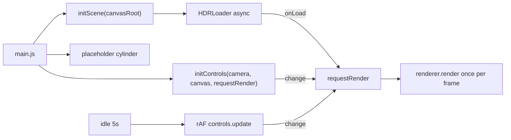

# T0.2 Scene dasar

## Keputusan yang sudah disetujui
- Nama file HDRI di disk adalah `public/hdri/studio_1k.hdr`. Sumbernya Poly Haven `studio_small_09` resolusi 1k, lisensi CC0.
- Mount canvas dibuat minimal (`#canvas-root`). `#app` tetap disimpan untuk UI di T1.2.
- Batas kamera: zoom 1.5–8, sudut atas-bawah dari 0.1 sampai `Math.PI/2 - 0.05`. Pan dimatikan (menyimpang dari PRD F1, dicatat di decisions.md).
- Warna silinder diambil dari token CSS `--brand-red`. Ground berupa plane sederhana dengan soft shadow.

## Alur

## File yang diubah

- [public/hdri/studio_1k.hdr](public/hdri/studio_1k.hdr): diunduh dari `https://dl.polyhaven.org/file/ph-assets/HDRIs/hdr/1k/studio_small_09_1k.hdr`. Ukuran sebenarnya (KB) dicatat karena ada risiko anggaran load 3 MB.
- [index.html](index.html): tambah `

` di sebelah `#app`.
- [src/styles/base.css](src/styles/base.css): `margin: 0`, `#canvas-root { position: fixed; inset: 0; background: radial-gradient(var(--bg-grad), var(--bg)) }`, dan canvas diberi `display: block; width: 100%; height: 100%`.
- [src/core/scene.js](src/core/scene.js) berisi:
  - `export function initScene(container)` yang mengembalikan `{ renderer, scene, camera }`.
  - `export function requestRender()`, digabung lewat satu flag rAF supaya hanya ada satu render per frame. Tidak ada loop render yang jalan terus.
  - Renderer dibuat dengan `antialias` dan `alpha: true`, memakai `ACESFilmicToneMapping`, exposure 1.0, `shadowMap.enabled`, dan tipe default `PCFShadowMap` (`PCFSoftShadowMap` sudah dihapus di r186).
  - Pixel ratio: `Math.min(devicePixelRatio, matchMedia('(pointer: coarse)').matches ? 1.5 : 2)`.
  - HDRI di-load dengan `HDRLoader` dari `three/addons/loaders/HDRLoader.js`, memakai `EquirectangularReflectionMapping` dan `scene.environment = hdr`. Background tidak diisi. `onError` memanggil `console.warn` dan scene tetap tampil dengan directional light.
  - Satu `DirectionalLight` dengan `castShadow` dan `mapSize` 1024. Kamera shadow-nya dibatasi sekitar ±2, `normalBias` 0.02, `radius` 4.
  - Ground berupa `PlaneGeometry` dengan `ShadowMaterial({ opacity: 0.3 })` dan `receiveShadow`, diletakkan di y=0.
  - `ResizeObserver` di container menjalankan `setSize(w, h, false)`, mengubah aspect, memanggil `updateProjectionMatrix`, lalu `requestRender`.
  - `requestRender()` langsung dipanggil setelah init, tanpa menunggu HDRI selesai.
- [src/core/controls.js](src/core/controls.js) berisi:
  - `export function initControls(camera, domElement, onChange)` yang mengembalikan `OrbitControls`.
  - Batas sesuai keputusan di atas, `enablePan = false`, `enableDamping = false`, dan `autoRotateSpeed` pelan.
  - Timer idle 5 detik mulai sejak init dan diulang setiap event `end`. Event `start` menghapus timer dan menghentikan loop rAF.
  - Saat idle: `autoRotate = true` dan loop rAF memanggil `controls.update()`. Event `change` yang dipicunya otomatis memanggil `onChange`.
  - Kalau `prefers-reduced-motion: reduce` aktif, auto-rotate tidak pernah dinyalakan.
- [src/main.js](src/main.js):
  - Hapus baris `style.background` yang inline.
  - Import `base.css`, lalu panggil `initScene` dan `initControls`. `controls.target` diset ke tengah tinggi silinder.
  - Tambah silinder sementara (`CylinderGeometry`, dasar di y=0, `castShadow`). Warnanya `getComputedStyle(document.documentElement).getPropertyValue('--brand-red').trim()`. Silinder ini dihapus di T0.3.

## Yang tidak dikerjakan
UI, i18n, router, stats.js, `preserveDrawingBuffer`, dan file self-check (tidak ada logika murni yang perlu dites).

## Setelah implementasi
- Jalankan `npm run build` dan cek AC T0.2 di `npm run dev`, termasuk `--host` untuk HP.
- `docs/progress.md`: T0.2 diberi status in progress sampai Barkah memvalidasi.
- `docs/decisions.md`: catat `HDRLoader`, `PCFShadowMap`, pan dimatikan, `alpha: true` dengan gradasi CSS, nama file HDRI, angka batas kamera, dan silinder sementara di `main.js`.
- `docs/known-issues.md`: catat penghapusan `PCFSoftShadowMap` dan peringatan `RGBELoader` di r186, serta risiko ukuran HDRI untuk anggaran 3 MB.
- Kirim ringkasan berbahasa Indonesia, langkah klik untuk mengecek, dan commit message. Berhenti, tidak lanjut ke T0.3.