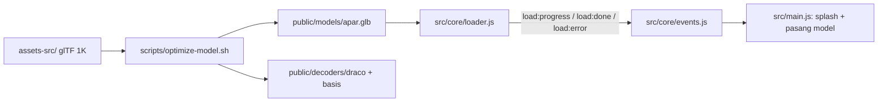

# T0.3 — Pipeline aset & load model

## Alur

## 1. Aset & pipeline
- Pasang `@gltf-transform/cli` sebagai devDependency, dengan versi dikunci (Q3).
- Tidak perlu mengunduh: aset sudah ada di `assets-src/korean_fire_extinguisher_01/`, yaitu `korean_fire_extinguisher_01_1k.gltf`, `.bin`, dan 9 tekstur (body/glass/paper × diff/nor/arm). Input script: `assets-src/korean_fire_extinguisher_01/korean_fire_extinguisher_01_1k.gltf`. Tambahkan `assets-src/` ke [.gitignore](.gitignore) (Q4).
- Isi [scripts/optimize-model.sh](scripts/optimize-model.sh), dijalankan lewat Git Bash:
  - Pakai `npx gltf-transform optimize <in> public/models/apar.glb --compress draco --texture-size 1024 --simplify false`. Opsi `--simplify false` memastikan geometri tidak diubah (mesh tidak dipotong atau disederhanakan).
  - Kalau `command -v toktx` tersedia, pakai `--texture-compress ktx2`. Kalau tidak, pakai `--texture-compress webp` (Q1).
  - Copy `node_modules/three/examples/jsm/libs/draco/gltf/*` ke `public/decoders/draco/`, dan `libs/basis/*` ke `public/decoders/basis/` (Q2).
- Jalankan script, lalu `npx gltf-transform inspect public/models/apar.glb` untuk laporan ukuran, jumlah mesh, dan nama material.

## 2. Kode
- [src/core/events.js](src/core/events.js): event bus kecil `on(name, fn)` / `emit(name, data)` berbasis `EventTarget`.
- [src/core/loader.js](src/core/loader.js): `loadModel(renderer)` memakai `GLTFLoader` + `DRACOLoader` (`/decoders/draco/`) + `KTX2Loader` (`/decoders/basis/`, `detectSupport(renderer)`). Loader dibuat sekali dan dipakai ulang saat Retry.
  - Progress diambil dari callback `onProgress` per byte (`loaded/total`) dan dikirim sebagai `load:progress` (0–100). Kalau `total` tidak diketahui (`lengthComputable` false), dikirim `null` dan splash menampilkan bar tanpa angka.
  - Setelah selesai, kirim `load:done` (gltf). Kalau gagal, kirim `load:error`.
- [index.html](index.html): markup `#splash` berisi teks loading, bar, %, teks koneksi lambat (tersembunyi), pesan error, dan tombol Retry (tersembunyi). Semua teks memakai atribut `data-i18n`.
- [src/i18n/en.json](src/i18n/en.json) + [src/i18n/id.json](src/i18n/id.json): key `splash.loading`, `splash.slow`, `splash.error`, `splash.retry` dalam dua bahasa (Q5). Untuk sementara `main.js` mengisi `[data-i18n]` di splash dari `en.json`. Di T1.1 diganti ke `t()`.
- [src/ui/components.css](src/ui/components.css): style splash memakai token (`--surface-solid`, `--accent`, `--text-muted`, `--danger`). Overlay fixed layar penuh, tombol minimal 44px, fade out yang menghormati `prefers-reduced-motion`. File ini di-import di `main.js`.
- [src/main.js](src/main.js) (Q6–Q9):
  - Hapus silinder placeholder.
  - Panggil `loadModel(renderer)`. Timer 8 detik menampilkan `splash.slow`.
  - Saat `load:done`: skala model diset agar tingginya 1,2 (dari `Box3`), alas di y=0, posisi di tengah X/Z. Aktifkan `castShadow` pada mesh, set `controls.target` ke tengah tinggi model, `requestRender()`, lalu sembunyikan splash.
  - Saat `load:error`: tampilkan pesan error dan tombol Retry. Klik Retry mereset tampilan splash lalu memanggil `loadModel` lagi tanpa reload halaman (Q7).
  - Progress hanya mengikuti model; HDRI tetap dimuat terpisah (Q9).
- Fallback WebGL tidak dikerjakan di sini (Q11).

## 3. Verifikasi & dokumen
- `npm run build` harus sukses. Cek `npm run dev`: splash % muncul lalu APAR tampil. Lalu cek DevTools Network: Offline lalu reload memunculkan error + Retry; kembali Online lalu Retry memunculkan model. Cek juga Slow 3G untuk teks koneksi lambat.
- Laporkan: ukuran `apar.glb` (KB, harus < 2 MB), jumlah mesh, nama material, dan perkiraan total transfer awal (HDRI + JS gzip + GLB) dibanding batas 3 MB (Q10).
- Update dokumen:
  - `docs/progress.md`: T0.3 berstatus 🟨, lalu ✅ setelah Barkah memvalidasi.
  - `docs/decisions.md`: WebP sebagai cadangan, `--simplify false`, normalisasi tinggi 1,2, Retry tanpa reload, teks splash sementara dari `en.json`, fallback WebGL ditunda ke T3.2.
  - `docs/known-issues.md`: `toktx` tidak ada sehingga dipakai WebP, temuan ukuran/anggaran, dan nama material untuk T1.5.
  - `docs/content-and-assets.md`: hanya bila perlu, tanpa menulis ulang.
- Ringkasan untuk Barkah dalam Bahasa Indonesia, berisi checklist AC T0.3, langkah klik, dan saran commit message. Tidak lanjut ke T0.4 sebelum Barkah konfirmasi.