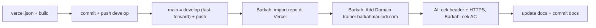

# T0.4 — Deploy Vercel + subdomain

Keputusan validasi (Q1–Q9) yang dipakai: `main` = situs live (digabung hanya setelah validasi), penggabungan via fast-forward tanpa PR, cache berbeda untuk file ber-hash vs tidak ber-hash, bagian 4 env-setup dilewati (repo `ludioo/apar-3d-trainer` sudah publik), Umami dilewati sampai T3.6, setup via dashboard Vercel, preview tetap terkunci login, project `apar-3d-trainer` di akun Vercel yang sama dengan situs utama.



## 1. Kode (AI)
File baru [vercel.json](vercel.json) di root:

```json
{
  "headers": [
    { "source": "/assets/(.*)", "headers": [{ "key": "Cache-Control", "value": "public, max-age=31536000, immutable" }] },
    { "source": "/(models|decoders|hdri)/(.*)", "headers": [{ "key": "Cache-Control", "value": "public, max-age=86400" }] }
  ]
}
```

- `/assets` = output Vite ber-hash, aman di-cache 1 tahun.
- `/models`, `/decoders`, `/hdri` nama file tetap, jadi cache 1 hari agar update model (mis. T3.1) sampai ke pengunjung paling lambat sehari.
- `npm run build` harus sukses, lalu commit `chore(T0.4): add vercel.json cache headers` dan push `develop`.
- `git push origin develop:main` (fast-forward; `main` saat ini hanya berisi `b654bb8`, ancestor `develop`).

## 2. Pandu Barkah (satu langkah per pesan, tunggu konfirmasi)
1. Cek repo https://github.com/ludioo/apar-3d-trainer: branch `main` sudah berisi kode.
2. Vercel Dashboard → Add New… → Project → Import `apar-3d-trainer` → preset Vite, build `npm run build`, output `dist` → env var dilewati → Deploy → buka URL `*.vercel.app`.
3. Project apar-3d-trainer → Settings → Domains → Add `trainer.barkahmauludi.com` (Production) → laporkan status.
4. Hanya jika Invalid Configuration setelah ±10 menit: Barkah salin nilai CNAME dari layarnya; saya tidak menebak nilainya. Tambah record di Domains tim → barkahmauludi.com → DNS Records (Name `trainer`). Fallback Rumahweb sesuai env-setup bagian 6.

## 3. Verifikasi
- AI (read-only): `curl -I` ke `https://trainer.barkahmauludi.com/`, `/models/apar.glb`, dan satu file `/assets/*.js` → cek HTTPS 200 + nilai `Cache-Control`.
- Barkah cek AC T0.4: gembok HTTPS (HP + laptop), status Valid Configuration, barkahmauludi.com tetap normal, push → auto update (dibuktikan oleh push commit docs ke `main` di langkah 4).

## 4. Setelah Barkah konfirmasi lolos
- [docs/progress.md](docs/progress.md): T0.4 ✅ + catatan URL.
- [docs/decisions.md](docs/decisions.md): alur branch (develop → main setelah validasi, fast-forward), cache 1 hari untuk aset tanpa hash (menyimpang dari env-setup bagian 9), Umami ditunda ke T3.6, preview terkunci login.
- [docs/env-setup.md](docs/env-setup.md): bagian 9 disesuaikan dengan header baru (edit kecil, bukan tulis ulang).
- [docs/known-issues.md](docs/known-issues.md): temuan saat deploy (mis. status domain, waktu propagasi) atau "tidak ada issue baru".
- Commit docs di `develop` → push → fast-forward `main` (sekaligus bukti AC auto-deploy).
- Ringkasan Bahasa Indonesia + langkah cek + commit message. Tidak lanjut ke T1.1 sebelum dikonfirmasi.