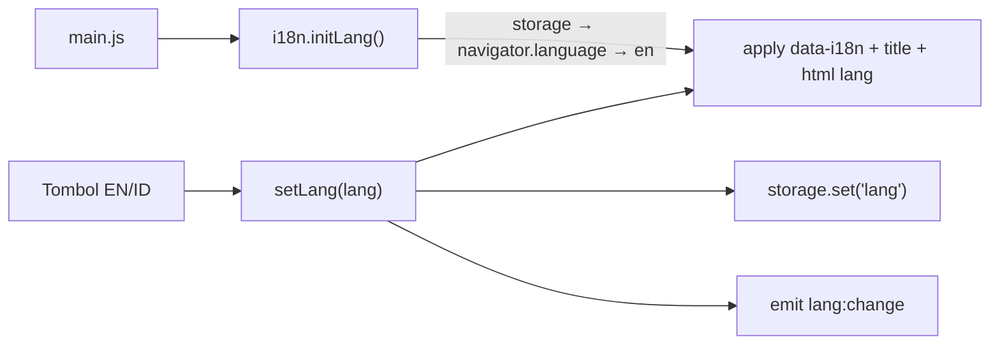

# T1.1 — i18n engine + toggle EN|ID

Semua keputusan dari validasi (Q1–Q12) sudah disetujui Barkah.

## Alur

## File yang diubah

- [src/core/storage.js](src/core/storage.js) — isi minimal: `get(key, fallback)` / `set(key, value)` dengan prefix `apar3d:`, `JSON.parse/stringify`, try/catch (gagal = kembalikan fallback / diam). `schemaVersion` belum dipakai (Q5); batas configs/attempts ditambah di T1.7/T2.3.
- [src/i18n/i18n.js](src/i18n/i18n.js) — import statis `en.json` + `id.json` (kecil, tanpa fetch). Ekspor:
  - `t(key)` → `dict[lang][key] ?? dict.en[key] ?? key` (Q7)
  - `getLang()`, `setLang(lang)` → simpan, terapkan ke DOM, `emit('lang:change', lang)` (Q8: tanpa analytics)
  - `initLang()` → storage → `navigator.language` diawali `id` → `id`, selain itu `en` (Q4)
  - `applyDom(root = document)` → `[data-i18n]` textContent, `document.title = t('app.title')`, `document.documentElement.lang`
- [src/i18n/en.json](src/i18n/en.json), [src/i18n/id.json](src/i18n/id.json) — key flat seperti sekarang (`app.name`, `splash.*`), tambah salin persis dari [docs/content-and-assets.md](docs/content-and-assets.md): `app.title`, `app.tagline`, `tabs.configure|train|results|about`, `pass.pull|aim|squeeze|sweep`, `disclaimer`, `price.illustrative`, `credits.assets`, `emergency.title|fire|general|source` (Q3), plus `lang.label` ("Language"/"Bahasa"), `lang.en`/`lang.id` ("EN"/"ID"). Bold `**113**` di `emergency.*` disimpan sebagai teks biasa (markdown dokumen, bukan isi copy).
- [index.html](index.html) — tambah `<header class="topbar">` sebelum `#canvas-root`: `app.name` (logo teks), `app.tagline`, grup tombol `role="group"` berisi dua `<button data-lang="en|id">` dengan `aria-pressed` (Q6).
- [src/main.js](src/main.js) — hapus blok `ponytail` splash yang baca `en.json` langsung; panggil `initLang()` paling awal (sesuai architecture alur data #1); wire klik tombol `data-lang` → `setLang`, update `aria-pressed` + `aria-label` grup via `t('lang.label')` di `on('lang:change')`; import `layout.css`.
- [src/styles/layout.css](src/styles/layout.css) — `.topbar` fixed atas, tinggi 56px, `background: var(--surface)` + `backdrop-filter: blur(12px)` (fallback `--surface-solid`), `z-index` di atas splash (Q9, Q10); tagline disembunyikan di bawah 1024px (Q2).
- [src/ui/components.css](src/ui/components.css) — `.lang-toggle` segmented: tombol min 44×44px, aktif `--accent`/`--accent-ink`, `:focus-visible` outline, transisi dimatikan di `prefers-reduced-motion`. Font tetap system (Q11).
- `scripts/self-check.js` (baru) + script `"check": "node scripts/self-check.js"` di [package.json](package.json) — `assert.deepStrictEqual` key `en.json` vs `id.json`, dan tidak ada nilai kosong (Q7). Tanpa dependency.

## Verifikasi

- `npm run check` lalu `npm run build` sukses.
- Cek lokal: toggle ganti judul tab browser + tagline tanpa reload; refresh → bahasa tetap; offline → pesan error & "Coba lagi"/"Retry" ikut berganti; `localStorage` berisi `apar3d:lang`.
- Commit + push ke `develop` → preview Vercel untuk cek HP (Q12). `main` tidak disentuh sebelum Barkah menyatakan lolos.

## Docs setelah implementasi

- [docs/progress.md](docs/progress.md) — T1.1 status + tanggal + catatan.
- [docs/decisions.md](docs/decisions.md) — topbar minimal di T1.1 (dilanjut T1.2) & di atas splash; `apar3d:lang` string polos tanpa `schemaVersion`; fallback EN; default `id*` → ID; `lang_change` analytics ditunda ke T3.6; tagline sebagai bukti ganti bahasa.
- [docs/known-issues.md](docs/known-issues.md) — temuan saat implementasi (atau "tidak ada issue baru").
- Ringkasan Bahasa Indonesia + checklist AC T1.1 + langkah klik + commit message (`feat(i18n): T1.1 EN/ID toggle, i18n engine, storage wrapper`).
