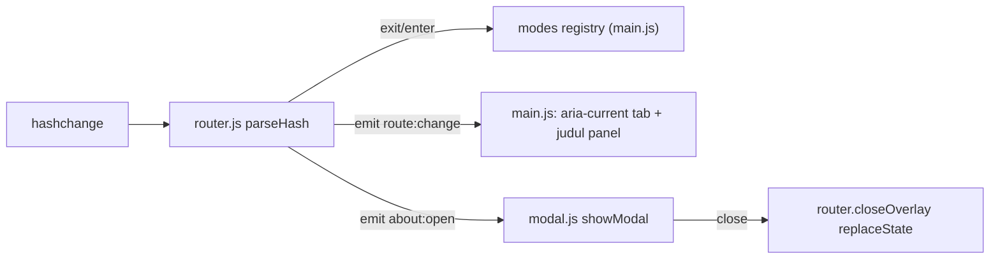

# T1.2 — Layout UI & router

Keputusan yang sudah disetujui: About = link di topbar yang membuka modal (`#about`), lalu kembali ke tab sebelumnya saat ditutup. Isi modal = teks i18n yang sudah ada. Panel hanya menampilkan judul tab. Toast dibuat tanpa pemicu. Di HP, tab ada di baris kedua. Bottom sheet punya 2 posisi berhenti (30%/80%) dan bisa diketuk. Hash kosong atau tidak dikenal diarahkan ke `#configure`. Kode sheet ditaruh di file baru `src/ui/sheet.js`. Area 3D di HP dimulai di bawah topbar.

## Alur

## File yang diubah

- [index.html](index.html)
  - Topbar berisi brand, `<nav class="tabs">` dengan 3 `<a href="#configure|#train|#results" data-i18n="tabs.*">`, dan `.topbar__actions` (toggle EN|ID + `<a href="#about">`).
  - `<section id="panel">` berisi tombol `.panel__handle` (`aria-expanded`, `aria-controls`), `<h2 id="panel-title">`, dan `#panel-body` kosong.
  - `<dialog id="about" class="modal">` berisi disclaimer, `emergency.*`, `credits.assets`, dan tombol Close.
  - `
`.
- [src/core/router.js](src/core/router.js) (~45 baris)
  - `parseHash(hash, modes)` (pure): mengembalikan nama mode, `'about'`, atau fallback `'configure'`.
  - `initRouter(modes)`: `exit?.()` lalu `enter?.()`, emit `route:change {mode, prev}`. `#about` membuat mode tetap aktif dan emit `about:open`. Hash tidak dikenal ditulis ulang via `replaceState`.
  - `closeOverlay()` dan `getMode()`. Tidak ada efek samping saat file di-import.
- [src/ui/modal.js](src/ui/modal.js) (~20 baris): `openModal(dialog, onClose)` / `closeModal(dialog)` memakai `<dialog>` native. Esc, fokus, backdrop, dan top layer sudah otomatis. Klik di backdrop menutup modal.
- [src/ui/toast.js](src/ui/toast.js) (~20 baris): `showToast(message, ms = 3000)`. Timer di-reset tiap kali dipanggil.
- `src/ui/sheet.js` (baru, ~60 baris)
  - `nearestSnap(visiblePx, snapsPx)` (pure) dan `initSheet(panel, handle)`.
  - Pointer events di handle (`touch-action: none`, pointer capture). Gerakan < 6px dianggap tap (toggle). Selain itu snap ke 30% atau 80% `innerHeight`, mana yang lebih dekat.
  - Enter/Space di handle = toggle. Di ≥1024px (`matchMedia`) drag diabaikan dan inline style dibersihkan.
- [src/main.js](src/main.js): `initSheet`, `initRouter({ configure: {}, train: {}, results: {} })`. Event `route:change` mengatur `aria-current` + judul panel `t('tabs.'+mode)`. Event `lang:change` memperbarui judul + aria-label. Event `about:open` menjalankan `openModal(about, closeOverlay)`.
- [src/styles/layout.css](src/styles/layout.css)
  - `--topbar-h` HP = 56px + baris tab 44px. Topbar dua baris di HP, satu baris di desktop.
  - Panel HP: fixed bottom, `height: 80dvh` (fallback `vh`), collapsed `translateY(50dvh)`, `.is-expanded` → `translateY(0)`, `z-index: 50`.
  - Desktop: kanan 360px, top 56+16, margin 16, glass, `--radius-14`, `--shadow-panel`, handle disembunyikan.
- [src/styles/base.css](src/styles/base.css): `#canvas-root` di HP: `top: var(--topbar-h)`, `height: calc(70dvh - var(--topbar-h))`. Di ≥1024px kembali `inset: 0`. `scene.js` tidak perlu diubah karena ResizeObserver-nya sudah memantau `#canvas-root`.
- [src/ui/components.css](src/ui/components.css): gaya tab (aktif = `--accent`, focus ring), handle 44px dengan grabber pill, `.modal` + `::backdrop`, toast (`z-index: 130`). Blok `prefers-reduced-motion` diperluas. Hanya pakai token, tanpa hex.
- [src/i18n/en.json](src/i18n/en.json) / [src/i18n/id.json](src/i18n/id.json): `nav.label` "Main navigation"/"Navigasi utama", `sheet.toggle` "Expand or collapse panel"/"Buka atau tutup panel", `modal.close` "Close"/"Tutup".
- [scripts/self-check.js](scripts/self-check.js): assert `parseHash` ('' / `#train` / `#xyz` / `#about`) dan `nearestSnap` (di bawah dan di atas titik tengah).

Urutan z-index: kanvas, panel 50, splash 100, topbar 110, toast 130. Dialog berada di top layer browser.

## Risiko

- Address bar HP mengubah tinggi layar. Diatasi dengan `dvh` + fallback, dan perhitungan snap membaca `innerHeight` saat jari dilepas.
- Panel tertutup splash saat loading (disengaja). About tetap bisa dibuka saat loading.

## Penutup task

- `npm run build` + `npm run check` sukses di branch `develop`.
- Update `docs/progress.md`. Catat di `docs/decisions.md`: `<dialog>` native, link biasa (bukan ARIA tablist), area 3D HP 70% menggantikan ~60vh, `sheet.js` baru, API router berupa objek modes. Update `docs/known-issues.md` (catatan dvh).
- Tampilkan checklist AC T1.2 + langkah cek (localhost `#train`, Back/Forward, `#xyz`, About, HP via `npm run dev -- --host` atau DevTools < 1024px).
- Commit: `feat(ui): T1.2 layout — topbar tabs, hash router, desktop panel & mobile bottom sheet, modal/toast`.