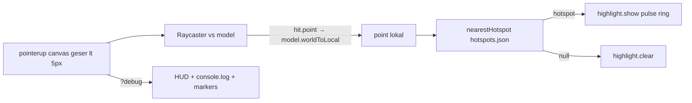

# T1.3 — Hotspot posisi & picking

Keputusan yang sudah disetujui (grill): koordinat lokal model (pra-skala) dalam meter; klik aktif di semua tab; threshold geser 5 px; ring selalu menghadap kamera + selalu terlihat; ring tetap sampai klik lain/kosong; klik di luar radius = clear; `?debug` HUD EN-only + markers; nearest-in-radius dengan radius per-id; `cameraView` diisi perkiraan; title/body dipisah dari content-and-assets; assert di `self-check.js`.

## Alur

## File yang diubah / diisi

- [src/data/hotspots.json](src/data/hotspots.json) — array 6 item sesuai [data-model.md](docs/data-model.md):
  - `id`: `pin` | `handle` | `nozzle` | `gauge` | `label` | `body`
  - `position` [x,y,z] lokal meter (pra-skala 1.2)
  - `radius` beda per bagian: pin/gauge ~0.025–0.03; handle/nozzle ~0.04; label ~0.05; body ~0.12 (cukup tabung, tidak mencakup base)
  - `cameraView`: `{ position, target }` dunia (perkiraan; final di T1.4)
  - `title` / `body` EN+ID **persis** dari tabel hotspot di [content-and-assets.md](docs/content-and-assets.md) (title = bagian tebal sebelum "—"; body = sisa; catatan kurung `handle` tidak disalin)
  - `sources`: `["usfa"]` atau `["usfa","permenaker"]` sesuai kolom Sumber

- [src/core/picking.js](src/core/picking.js) (~40 baris)
  - `nearestHotspot(point, hotspots)` **pure**: di antara hotspot yang `distance(point, position) ≤ radius`, pilih jarak terkecil; else `null`. Dipakai self-check + runtime.
  - `pickFromNdc(ndcX, ndcY, camera, model, hotspots)`: `Raycaster.setFromCamera` → intersect model → `model.worldToLocal(hit.point.clone())` → `nearestHotspot`.

- [src/core/highlight.js](src/core/highlight.js) (~60 baris)
  - `initHighlight(scene, camera, requestRender)` → `{ show(worldPos), clear() }`
  - Mesh: `RingGeometry` / torus tipis, `MeshBasicMaterial({ color: 0xffc629, depthTest: false, transparent })`, `renderOrder` tinggi, tiap frame `lookAt(camera)`.
  - Pulse: rAF scale 1↔1.25 + `requestRender()`; `prefers-reduced-motion: reduce` → diam (skala tetap).
  - `clear()` hentikan rAF dan lepas dari scene.

- [src/main.js](src/main.js) — setelah `load:done`:
  - Simpan referensi `model`.
  - `initHighlight` + pointer di `renderer.domElement`: `pointerdown` simpan clientXY; `pointerup` jika jarak &lt; 5 px → NDC dari `getBoundingClientRect` → `pickFromNdc` → `show` di `model.localToWorld(hotspot.position)` atau `clear`.
  - Jika `URLSearchParams` punya `debug`: buat HUD `#debug-hud` (pojok kiri bawah), tampilkan point lokal 3 desimal + id/jarak terdekat (atau "none"), `console.log` sama; tambah 6 sphere kecil di posisi hotspot (dunia) untuk cek visual. Teks HUD hardcode EN (catat pengecualian di decisions).

- [index.html](index.html) — optional: shell kosong `
` ATAU buat via JS di main (pilih buat via JS supaya HTML bersih).

- [src/ui/components.css](src/ui/components.css) — gaya `.debug-hud` (monospace, glass, z-index di bawah toast/topbar, di atas kanvas; hanya token).

- [scripts/self-check.js](scripts/self-check.js) — import `nearestHotspot`; assert: hit dalam 1 radius; label menang vs body saat overlap; di luar semua radius → `null`.

**Tidak disentuh:** `cameraTween.js`, `features/configurator/hotspots.js` (pin HTML/kartu = T1.4), i18n keys baru (debug tidak diterjemahkan).

## Cara isi posisi (saat implementasi)

1. Setelah model load, hitung centroid lokal material `korean_fire_extinguisher_01_glass` → `gauge`, `…_paper` → `label`.
2. Pin / handle / nozzle / body: seed dari bounding box anatomi APAR Korea (pin di tuas atas, handle atas, nozzle ujung hose, body pusat silinder di atas base) lalu refine lewat `?debug` klik di browser.
3. Kirim ke Barkah: daftar 6 posisi + screenshot `?debug` dengan markers + ring di tiap bagian.

## Risiko

- OrbitControls juga listen pointer di canvas — threshold 5 px mencegah false pick saat orbit; tidak `stopPropagation` di pointerdown agar orbit tetap jalan.
- Render-on-demand: loop pulse wajib panggil `requestRender`; `clear` wajib cancel rAF (hindari leak).
- Skala model: semua hit→local lewat `model.worldToLocal` agar posisi JSON tetap valid saat T1.6 mengubah scale capacity.

## Penutup task

- `npm run build` + `npm run check` sukses.
- Update [docs/progress.md](docs/progress.md) (T1.3 ✅), [docs/decisions.md](docs/decisions.md) (lokal pra-skala, debug EN-only, ring depthTest false, klik semua tab sementara), [docs/known-issues.md](docs/known-issues.md) bila ada temuan posisi/material.
- Tampilkan checklist AC T1.3 + langkah cek (`http://localhost:5173/?debug`) + daftar posisi + commit message.
- **Tidak** lanjut T1.4 sampai Barkah konfirmasi AC.