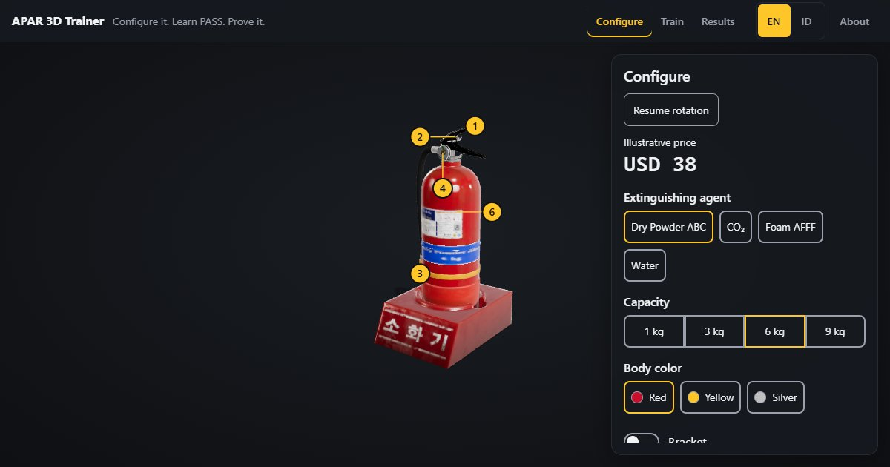

# APAR 3D Trainer & Configurator

A browser-based 3D fire extinguisher (APAR) demo combining product configuration, guided PASS practice, and a quiz with downloadable results. Built by Barkah Mauludi as a web 3D portfolio project.

[Open the live demo](https://trainer.barkahmauludi.com/) · [Barkah's portfolio](https://barkahmauludi.com)



## Features

- Rotate and zoom the 3D extinguisher; select six hotspots to focus the camera and read about each part.
- Configure four agents (Dry Powder ABC, CO2, Foam AFFF, Water), four capacities (1/3/6/9 kg), three body colors, and an optional bracket. Specifications and illustrative prices update with your choices in IDR or USD.
- Save up to 10 named configurations in your browser, then load or delete them.
- Practice Pull, Aim, Squeeze, Sweep with guided interactions, a hold action, a sweep slider, and fire/spray effects.
- Answer eight quiz questions, including part identification, with feedback and explanations.
- Review your score, answer breakdown, and up to 20 saved attempts in Results.
- Download a training report as PDF, or export the active configuration's specification sheet with a 3D product screenshot.
- Switch between English and Indonesian. Use keyboard controls, reduced motion, and a static fallback when WebGL cannot start.

## Stack

Vanilla JavaScript ES modules, three.js, Vite, HTML, and CSS custom properties. The GLB model uses Draco geometry compression and WebP textures. jsPDF loads on demand for PDF export; browser localStorage stores configurations, quiz history, language, and the optional participant name.

The application runs client-side without a backend or login. GitHub hosts the repository; Vercel hosts the live demo.

## Run locally

Use Node.js 22.12+ and npm. In a local checkout of this repository:

```bash
npm ci
npm run dev
```

Open the local URL printed by Vite. Check the project and preview a production build with:

```bash
npm run check
npm run build
npm run preview
```

`npm run check` runs the project's Node-based self-checks. The build also regenerates the lossless gzip copy of the existing HDRI. Open the preview URL printed by Vite after the build succeeds.

## Credits and fire-safety sources

- Code: [MIT License](LICENSE), copyright 2026 Barkah Mauludi.
- 3D model: [Korean Fire Extinguisher 01](https://polyhaven.com/a/korean_fire_extinguisher_01), Poly Haven, CC0.
- HDRI: [Studio Small 09](https://polyhaven.com/a/studio_small_09), Poly Haven, CC0.
- README screenshot: captured from this application using the model and HDRI above.
- PDF library: [jsPDF](https://github.com/parallax/jsPDF), MIT.
- PASS and fire-safety reference: [U.S. Fire Administration, Choosing and Using Fire Extinguishers](https://www.usfa.fema.gov/prevention/home-fires/prepare-for-fire/fire-extinguishers/).
- Indonesian reference: [Permenakertrans PER.04/MEN/1980 (PDF copy hosted by ITS)](https://www.its.ac.id/burb/wp-content/uploads/sites/106/2023/07/PER.04-1980-APAR.pdf).
- Agent/fire-class reference: [Damkar Banda Aceh, Jenis-jenis Alat Pemadam Api Ringan (APAR)](https://damkar.bandaacehkota.go.id/2020/08/09/jenis-jenis-alat-pemadam-api-ringan-apar/).
- Emergency-number reference: [Komdigi, Tentang Layanan Panggilan Darurat 112](https://layanan112.komdigi.go.id/tentang).

See [content and asset records](docs/content-and-assets.md) for source details and attribution.

## Demo limits

Prices, specifications, capacity scaling, and agent labels are illustrative. All variants reuse the same model, hose/nozzle, and pressure gauge; individual extinguisher parts remain static. Saved data stays in the current browser's localStorage and does not sync between devices. Clearing site data removes those records.

Demo for portfolio purposes. Based on USFA guidance and Permenakertrans PER.04/MEN/1980. Not a substitute for certified fire-safety training.

## Project documentation

- [Product brief](docs/PRD.md)
- [Architecture](docs/architecture.md)
- [Implementation plan](docs/implementation-plan.md)
- [Progress](docs/progress.md) and [known issues](docs/known-issues.md)
- [Acceptance criteria](docs/acceptance-criteria.md)
- [Contributor and agent rules](AGENTS.md)
